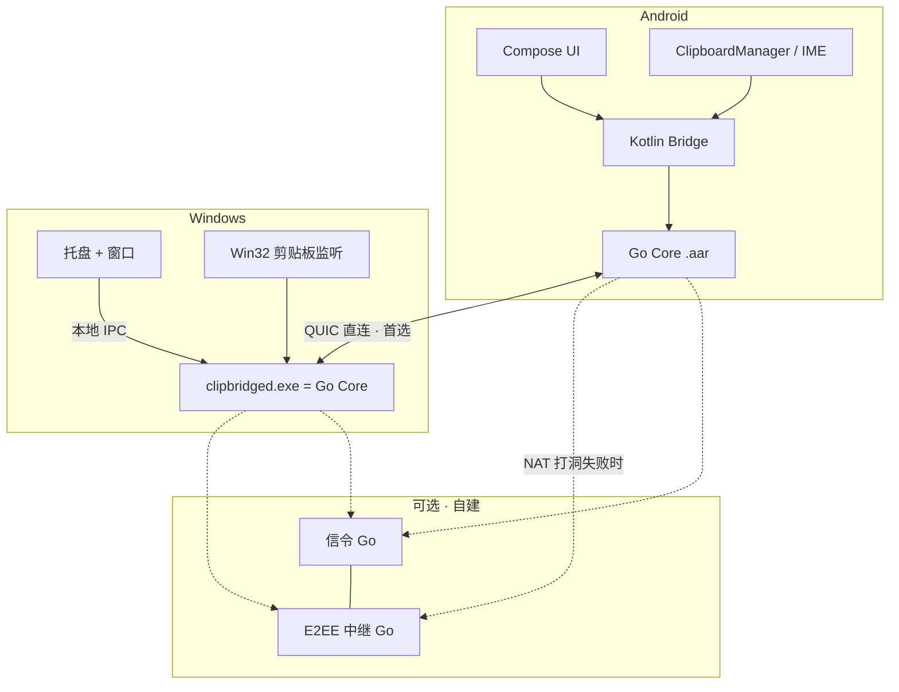

# ClipBridge 架构与技术原理

> 本文回答"**为什么这样能跑通**"，不是功能清单。每个选择都给出原理、参数和失败模式。

---

## 0. 一句话架构

> **一份 Go 协议核心，三端共用；局域网 QUIC 直连优先，Noise 握手做身份，QUIC 连接迁移 + 0-RTT 恢复做"秒级重连"；剪贴板走"先报元数据、按需拉正文"，文件走"分块 + 位图断点续传"。**

---

## 1. 为什么协议核心必须只写一份

跨设备同步类项目最常见的死法不是"功能没做完"，而是**协议漂移**：Android 端的 Kotlin 实现和 Windows 端的 C# 实现，对同一个字段的边界情况理解不一致，导致"手机能收到平板的，电脑收不到手机的"，且只在特定内容/特定网络下复现。三端各写一遍 = 三份加密实现、三份状态机、三份分块逻辑，bug 数量按平方增长。

**方案：核心逻辑写一次，编译到三端。**

| 层 | 语言 | 三端如何获得 |
|---|---|---|
| 身份/加密/握手/发现/传输/分块/状态机/本地数据库 | **Go** | 编译成各平台产物 |
| Android UI | Kotlin + Jetpack Compose | 通过 `gomobile bind` 生成的 AAR 调用核心 |
| Windows UI | 托盘 + WinUI/Wails（可选 C#） | 核心编译为 `clipbridged.exe` 后台进程，UI 通过本地 IPC 调用 |
| 服务端（信令/中继） | **Go** | 同一套协议代码直接复用 |

**为什么 Go 而不是 Rust/KMP**

- Go 交叉编译是一等公民：`GOOS=windows`、`GOOS=android` 一条命令出产物，**不需要 MSVC、不需要 CMake**（本机恰好都没有）。
- `gomobile bind` 直接产出 Android 用的 `.aar`，Kotlin 侧像调用普通类一样调用。
- 服务端生态（QUIC、mDNS、Noise）成熟且是同一份代码。
- 代价：Android 端 APK 体积 +6~10 MB（Go runtime），可接受。

**平台专有的部分（必须原生写，无法共用）**

- Android 剪贴板读写（`ClipboardManager`）、前台服务、生物识别、SAF 文件选择
- Windows 剪贴板监听（`AddClipboardFormatListener` / `WM_CLIPBOARDUPDATE`）、DPAPI、托盘

这两块通过一个窄接口回调进 Go 核心，接口面控制在 **10 个方法以内**，这是防止平台代码反噬架构的关键纪律。



---

## 2. 分层模型

```
L5  应用层     剪贴板同步 / 文件传输 / 设备组 / 规则引擎
L4  会话层     设备身份、配对、信任等级、会话恢复、权限
L3  传输层     QUIC(TLS1.3) 多路复用 · 帧协议 · 流控 · ACK
L2  安全层     Noise_IK 握手 · X25519 · ChaCha20-Poly1305 · SAS 验证
L1  发现层     mDNS · BLE · Wi-Fi Direct · 缓存地址 · 云信令
L0  网络层     局域网 / Wi-Fi Direct / 热点 / 公网(打洞) / 中继
```

**关键纪律：上层不感知下层用的是哪条通道。** 应用层只看到"和设备 X 有一条可靠加密流"，它是走 LAN、Wi-Fi Direct 还是中继，由 L1/L0 自行竞速决定并随时切换。这是"断联后自动快速重连"能做到的前提——**换通道对上层是透明的，不需要重新配对、不需要重传已完成的分块**。

---

## 3. 设备身份：一台设备 = 一对长期密钥

首次启动生成：

```
静态身份密钥  Ed25519 keypair        —— 签名，证明"我是这台设备"
静态 DH 密钥  X25519 keypair         —— Noise 握手用（可由 Ed25519 转换，但独立生成更干净）
device_id     = base32(SHA-256(ed25519_pub))[:26]   —— 人类可读、可比对
device_fp     = SHA-256(x25519_pub) 前 8 字节的 emoji/单词映射 —— 给人眼核对用
```

**私钥存放（永不落明文盘）**

| 平台 | 存放方式 | 原理 |
|---|---|---|
| Android | Android Keystore，`setUserAuthenticationRequired(true)` | 密钥在 TEE/StrongBox 内，App 只能"请求使用"不能"读出"；开启生物识别后，密钥只有通过 `BiometricPrompt` 才解锁 |
| Windows | DPAPI（`CryptProtectData`，`CRYPTPROTECT_LOCAL_MACHINE` 不开）+ 可选 TPM | 密文绑定当前 Windows 用户账户，换用户/换机器无法解密 |
| Linux/macOS（后续） | Secret Service / Keychain | 同上 |

**生物识别的正确理解**：指纹从不离开 TEE，App 拿不到指纹数据。`BiometricPrompt` 成功 → 系统解锁 Keystore 里的密钥 → App 才能用它做签名/解密。所以"指纹登录"实质是**用指纹授权本机密钥的使用**，和"把指纹传到服务器验证"完全不同。

---

## 4. 握手：为什么用 Noise_IK，以及它如何让重连变快

### 4.1 握手模式选择

| 场景 | Noise 模式 | 往返 | 说明 |
|---|---|---|---|
| **首次配对**（互不知道对方公钥） | `Noise_XX` | 1.5-RTT | 双方在握手中互相传送静态公钥，之后用 SAS 让人眼确认 |
| **已配对重连**（知道对方公钥） | `Noise_IK` | **0.5-RTT** | 发起方第一条消息就能携带加密载荷；对方一收到即可回数据 |
| **QR 配对**（已通过二维码拿到对方公钥） | `Noise_IK` | 0.5-RTT | 二维码本身就是"带外可信信道" |

**这是"重连快"的第一根支柱**：已配对设备重连时，`IK` 模式下**第一个 UDP 包里就带上了加密的业务数据**（例如"我上线了，我的剪贴板序列号是 №1187"）。不需要"先握手三次再说话"。

密码学套件（固定，不做协商，避免降级攻击）：

```
DH        : X25519
Cipher    : ChaCha20-Poly1305
Hash      : SHA-256 (BLAKE2s 亦可)
协议名     : Noise_IK_25519_ChaChaPoly_SHA256
```

### 4.2 为什么不直接用 TLS 客户端证书

可以用，但 Noise 有三个实际优势：
1. 握手报文更小（无证书链、无 X.509 解析），适合塞进 BLE/NFC 引导包。
2. 静态公钥本身就是身份，**不需要 CA、不需要证书有效期管理**——这是去中心化配对的天然模型。
3. `IK` 的 0.5-RTT 语义比 TLS 1.3 的 0-RTT 更安全可控（TLS 0-RTT 有重放风险，需要额外防重放设计）。

QUIC 层仍用标准 TLS 1.3（因为 QUIC 强制），但**只用作传输加密**；**身份认证由内层 Noise 负责**。即使 TLS 证书被中间人替换，内层 Noise 握手会失败。这叫**双层加密 / 内层锚定身份**，代价是多几十字节开销，换来的是"不依赖任何证书体系"。

---

## 5. 传输：QUIC 及其两个决定性特性

选 QUIC 不是因为时髦，是因为它有两个特性直接命中本项目的核心难点。

### 5.1 连接迁移（Connection Migration）—— "重连快"的第二根支柱

TCP 连接由四元组 `(源IP, 源端口, 目的IP, 目的端口)` 标识，**手机从 Wi-Fi 切到 5G，源 IP 变了 = 连接必死**，必须重新建连 + 重新握手。

QUIC 连接由 **Connection ID** 标识，与 IP 无关。手机换网后：

```
新 IP 发出的包携带同一个 Connection ID
→ 对端识别出"还是这个连接"
→ 触发路径验证（PATH_CHALLENGE / PATH_RESPONSE，1 个 RTT）
→ 连接继续，加密上下文不变，正在传的文件不中断
```

**实测意义**：Wi-Fi→蜂窝切换时，文件传输不需要断点续传逻辑介入，连接层自己就扛过去了。这是 TCP 方案无论如何做不到的。

### 5.2 多路复用无队头阻塞

一条 QUIC 连接上并行开多个 Stream：

```
Stream 0（双向）  控制通道：心跳、设备状态、剪贴板元数据、ACK
Stream 1..n（单向）每个文件一条流
Stream m         剪贴板正文按需拉取
```

在 TCP 上，一个 20 GB 文件会把控制消息堵在后面（队头阻塞）。QUIC 每条流独立丢包重传，**传大文件时心跳照常、剪贴板照样秒同步**。一对多传输时，慢设备的流也不会拖累快设备。

### 5.3 参数

```
初始拥塞窗口     32 KB（局域网可调高到 1 MB，走 BBR）
空闲超时         30 s（心跳 10 s，容忍 2 次丢失）
0-RTT 恢复       开启，配合防重放窗口（见 §9.4）
最大流数量       双向 16 / 单向 256
Keep-alive       10 s PING（前台）/ 60 s（后台省电）
MTU 探测         开启（PLPMTUD），局域网常能跑到 1400+
```

### 5.4 局域网直连：TCP 通道（0.1.33 起）

QUIC 在用户态按包收发，一个 MTU 大小的 UDP 包就是一次系统调用。Windows 上这一次调用要几十微秒，
单条连接的吞吐于是被钉在每秒几万个包上——实测 40~50 MiB/s，跑不满千兆网线（119 MiB/s）。
TCP 有内核里的分段卸载与大块读写，同一台机器上能到 800 MiB/s 以上。

所以**局域网内的直连先试 TCP**（同一个端口号，TCP 监听与 QUIC 的 UDP 监听并存），QUIC 留给它擅长的
场景：配对、打洞、跨网、中继、IP 迁移。

- **安全模型不变。** 这条路上没有 TLS，也不需要：身份认证与加密本来就是内层 Noise_IK 做的
  （QUIC 里的自签 TLS 证书从不被校验，见 §4.2）。TCP 流上跑同一套 Noise 握手、记录层与后量子升级，
  对端必须在信任名单里。
- **兼容。** 对端是旧版本（没有 TCP 监听）时连接被立即拒绝，回落到 QUIC；TCP 被防火墙静默丢包时
  试一次（1.2 s）就记下，五分钟内不再对这台设备先试 TCP。
- **不用于**公网打洞出来的地址（那是 UDP 的 NAT 映射）与中继。

### 5.5 降级链

QUIC(UDP) 在部分企业网/校园网被封 UDP。降级顺序：

```
QUIC/UDP 443 或自定端口
  ↓ UDP 不通
TLS 1.3 over TCP（同样内层 Noise，仅失去连接迁移能力）
  ↓ 出口被限制
WebSocket over HTTPS（伪装成普通 HTTPS 流量，走中继）
```

---

## 6. 发现层：如何在 1 秒内找到设备

### 6.1 mDNS / DNS-SD（局域网主力）

```
服务类型   _clipbridge._udp.local
实例名     <device_id前8位>._clipbridge._udp.local
TXT 记录   v=1
          id=<device_id>
          fp=<x25519公钥指纹前16字节 base64>
          n=<设备名，UTF-8>
          t=phone|tablet|pc
          c=clip,file,folder,relay      # 能力位
          p=<QUIC端口>
```

**关键原理与坑**：

1. **TXT 里放公钥指纹**，发起方在发起 `Noise_IK` 前就知道该用哪个静态公钥 → 省掉一次"你是谁"的往返。
2. **不要只依赖组播**。很多家用路由器/AP 开了 **client isolation（AP 隔离）** 或 IGMP snooping，组播被丢弃。对策：
   - 缓存上次成功的 `IP:Port`，重连时**先直接单播 QUIC 打过去**，不等 mDNS（这是 §7 竞速的第 1 路）
   - mDNS 用 **unicast query（QU 位）** 而非纯组播，穿透性更好
   - 同时向上次子网的广播地址发一个自定义 UDP 探测包
3. Android 的 `NsdManager` 在部分机型有已知不稳定（回调不触发、解析超时）。**核心层自己实现 mDNS**（Go 侧），只用系统 API 做兜底，是三端共用核心的又一个理由。

### 6.2 BLE：不是传数据，是"存在感知 + 唤醒"

BLE 带宽只有几十 KB/s，**绝不用它传剪贴板/文件**。它的作用是：

- **低功耗常驻广播**：即使 Wi-Fi 断了、App 被冻结，BLE 广播仍可被对端扫到 → "这台设备就在附近" → 触发 Wi-Fi 侧连接尝试
- **隐私**：广播内容不是明文 device_id，而是 **可解析轮换标识符**：
  ```
  RPA = truncate(HMAC(pairing_group_key, floor(unix_time / 900)), 6 bytes)
  ```
  每 15 分钟轮换。只有持有 `pairing_group_key` 的己方设备能算出并匹配，陌生人扫到的是一串每 15 分钟变一次的随机数，**无法用于长期追踪**。

### 6.3 Wi-Fi Direct / 临时热点（无路由器场景）

- Android ↔ Android：Wi-Fi Direct（p2p group），实测可跑 100~250 Mbps
- Android ↔ Windows：Windows 的 Wi-Fi Direct 支持参差，**更稳的做法是手机开热点、电脑连上去**，之后一切照常走 mDNS + QUIC
- 二维码里直接编码热点 SSID + 密码，扫码即入网（见配对文档 §7）

### 6.4 公网 / 异地

```
STUN 获取自身公网映射
  → 通过信令服务器交换候选地址（类 ICE）
  → 双向同时打洞（UDP hole punching）
  → 成功率约 70~85%（对称 NAT 会失败）
  → 失败则落到 E2EE 中继
```

中继服务器**只转发密文**，它没有任何设备的私钥，看不到内容。它能看到的元数据仅限：谁在线、谁给谁发了多少字节、什么时候。

---

## 7. 自动重连：并行竞速状态机（本项目最核心的工程点）

用户明确指出"断联后自动连接非常重要且要快"。做到"1~3 秒"靠的不是把重试间隔调小，而是三件事：**并行、事件驱动、免握手恢复**。

### 7.1 并行竞速（Happy Eyeballs 变体，参考 RFC 8305）

断线后**同时**发起 6 路尝试，不排队：

```
t=0ms    路1: 上次成功的 IP:Port（QUIC 0-RTT）        ← 90% 的情况这条就赢了
t=0ms    路2: 缓存的其他历史地址（同子网 /24 内全部）
t=0ms    路3: mDNS 查询（unicast QU）
t=50ms   路4: 自定义 UDP 子网广播探测
t=200ms  路5: BLE 扫描结果里的地址提示
t=500ms  路6: 云信令拿最新地址 / 中继
```

**第一条完成 Noise 握手的通道立即启用，其余尝试全部取消。** 后到的通道如果明显更优（例如中继先连上、随后 LAN 通了），执行**热切换**：新通道握手完成 → 迁移未完成任务 → 关旧通道，业务无感。

### 7.2 事件驱动，而不是轮询

固定周期轮询是"慢"的根源。真正的触发源：

| 平台 | 事件源 | 触发动作 |
|---|---|---|
| Android | `ConnectivityManager.NetworkCallback.onAvailable/onLost/onCapabilitiesChanged` | 网络一变**立刻**清空退避计时器、重新竞速 |
| Android | `ScreenOn` 广播 | 用户点亮屏幕 → 立即健康检查（用户马上要用了） |
| Android | BLE 扫到己方设备 RPA | 对端就在附近 → 立即尝试 LAN 连接 |
| Android | 高优先级 FCM data 消息 | App 被系统冻结时，由对端通过服务器"叫醒"（见 §7.5） |
| Windows | `NotifyAddrChange` / WMI 网络事件 | 同上 |
| Windows | 系统从睡眠/休眠恢复 | 立即重连 |
| 两端 | QUIC PING 连续 2 次超时 | 进入 `RECONNECTING` |

### 7.3 退避策略（只在"确实找不到对端"时才退避）

```
0.3s → 0.6s → 1.2s → 2.5s → 5s → 10s → 30s → 60s（封顶）
每次乘以 [0.8, 1.2] 的随机抖动，防止多设备同时惊群
```

**任何上表中的事件发生 → 立即重置到 0.3s 并马上重试**，不等当前计时器。这条是"感觉很快"的关键：用户从电梯里出来连上 Wi-Fi 的瞬间就连上了，而不是"再等 30 秒下一轮"。

### 7.4 会话恢复：重连 ≠ 重新配对

重连时携带 **Resumption Ticket**：

```
ticket = AEAD_encrypt(resumption_key, {
    peer_device_id,
    session_id,
    last_recv_seq,        # 我收到的最后一条消息序号
    pending_transfers[],  # 未完成的文件 + 已完成分块位图摘要
    issued_at, expires_at # 有效期 7 天，滚动更新
})
```

对端解密后直接恢复会话上下文：**不重新扫码、不重新确认 SAS、不重传已完成分块、未确认的剪贴板自动补发**。

### 7.5 Android 后台的现实（必须诚实说明）

Android 对后台连接的限制是硬约束，任何 App 都无法绕过：

- **能做到**：`connectedDevice` 类型前台服务 + 常驻通知，正常情况下长期在线
- **能做到**：被冻结时，由对端通过服务器发**高优先级 FCM data message** 唤醒 App → App 起来后立刻走 §7.1 竞速重连（通常 1~3 秒内恢复）
- **做不到**：用户在"最近任务"里强行划掉 App、或厂商省电策略（华为/小米/OPPO/vivo 的自启动管理）冻结了 App **且禁用了推送**，此时无法保证在线

**产品对策**（诚实优于虚假承诺）：
1. 引导页明确告知，一键跳转到对应厂商的自启动/电池优化设置页
2. **连接健康分**：App 内显示"过去 7 天在线率 96%"，并指出是哪项权限拖了后腿
3. 对端 UI **绝不显示虚假在线**：超过心跳容忍期立刻标记为"离线（最后在线 3 分钟前）"
4. 离线期间发送的内容进入**待发队列**，对方一上线自动补投

---

## 8. 剪贴板同步的核心原理

### 8.1 打破回环：内容寻址 + 逻辑时钟 + 来源抑制

用户原始文档已识别出回环风险，这里给出可落地的三重防护：

```
1. 内容寻址   item_id = BLAKE3(canonical(payload))[:16]
              收到的 item_id 在最近 200 条内出现过 → 直接丢弃
2. 来源标记   写入本机剪贴板前，把 item_id 记入 recently_written 集合
              本机剪贴板监听器触发时，若新内容 hash ∈ recently_written → 判定为"自己刚写的"，不广播
              该集合条目 5 秒后过期（防止用户真的手动复制了同样的内容而被永久屏蔽）
3. 逻辑时钟   HLC (Hybrid Logical Clock) = (物理毫秒时间, 逻辑计数器, device_id)
              排序时先比物理时间，相同则比逻辑计数器，再相同则比 device_id
              → 不依赖设备间时钟同步，也能得到全局一致的顺序
```

`canonical()` 做规范化：统一换行为 `\n`、去掉尾部空白、Unicode NFC 归一化。**注意**：图片不做有损归一化，直接哈希原始字节。

### 8.2 多表示（Multi-Representation）：一次复制 = 一个内容的多种形态

这是"公式/物理符号能正确粘贴"的技术核心。系统剪贴板本来就是"同一内容的多格式容器"。ClipBridge 传输的是一个 **representation set**：

```json
{
  "item_id": "…",
  "hlc": "…",
  "source": "device_id",
  "reps": [
    {"mime": "text/plain;charset=utf-8", "size": 12,   "hash": "…", "inline": "E = mc²"},
    {"mime": "text/x-tex",               "size": 10,   "hash": "…", "inline": "E = mc^2"},
    {"mime": "application/mathml+xml",   "size": 340,  "hash": "…"},
    {"mime": "text/html",                "size": 520,  "hash": "…"},
    {"mime": "image/png",                "size": 48210,"hash": "…"}
  ],
  "preferred": "text/x-tex"
}
```

**按需拉取（Lazy Fetch）**：≤ 4 KB 的表示直接内联在元数据里（文本几乎总是内联，所以文本同步只要一个包）；大于 4 KB 的（图片、PNG 预览）只发 hash + size，**接收端在用户真正粘贴时才拉正文**。

这解决了一个原文档没提的实际问题：把 20 MB 的截图无条件推给 5 台设备是巨大浪费，而且拖慢文本同步。按需拉取后，一对多同步一张大图的即时成本是 5 × 200 字节。

**降级规则**：目标应用支持哪种格式由系统决定。写入本机剪贴板时，把所有可用表示**同时**放进系统剪贴板（Windows 支持多格式共存，Android 用 `ClipData` 多 item + MIME 列表），由目标应用挑它认识的。永远保证 `text/plain` 存在作为兜底。

### 8.3 物理符号与公式为什么会"粘贴变形"

根因是**编码与字体的混淆**，不是传输问题：

| 现象 | 根因 | 对策 |
|---|---|---|
| `m/s²` 变成 `m/s2` | 目标应用只接受 ASCII，或中间做了 NFKD 规范化把上标 `²`(U+00B2) 拆成 `2` | 传输层用 **NFC** 而非 NFKC/NFKD；绝不做"兼容性分解" |
| `θ̇`（带点导数）变成 `θ` + 乱码 | 组合字符 U+0307 被截断 | 按 **字素簇（grapheme cluster）** 而非码点截断 |
| `∑` 显示成方块 | 目标设备缺字体，**内容其实是对的** | UI 上提示"内容正确，是本机字体缺失"，并提供 PNG 表示作为替代 |
| Word 里粘贴公式丢格式 | Word 认 MathML/OMML，不认 LaTeX 纯文本 | 同时提供 `application/mathml+xml` 表示；Windows 端可额外生成 OMML |

**明确不承诺**：无法保证任意第三方 App 都能渲染 LaTeX/MathML。降级策略是确定的（纯文本永远可用 + PNG 预览兜底），但"在某某 App 里公式一定漂亮"不是本项目能担保的事。

### 8.4 Android 剪贴板的权限现实

Android 10（API 29）起，**只有获得焦点的前台 App 或当前默认输入法（IME）能读系统剪贴板**。这是系统级限制，不是 API 用法问题。

| 模式 | 实现 | 能力 | 合规性 |
|---|---|---|---|
| **标准模式**（默认） | App 内复制 / 分享菜单 / 快捷设置磁贴 / 通知栏按钮 / 悬浮球 | 需要用户一个动作触发发送 | ✅ 上架无风险 |
| **增强模式**（可选） | 内置一个 **ClipBridge 输入法**，用户设为默认 IME | **真正的跨 App 自动同步**：任何 App 里复制都能被捕获 | ✅ IME 读剪贴板是系统承认的合法用途 |
| ~~无障碍服务模式~~ | 用 AccessibilityService 监听 | 能用 | ❌ **不采用**：权限滥用、Play/国内商店审核高风险、厂商杀后台更狠 |

增强模式的输入法必须做到：**离线、不上传按键、开源可审计**，并在首次启用时用大字明确告知"这个输入法不会记录你的输入"。这是取得用户信任的必要条件。

Windows 侧无此限制：`AddClipboardFormatListener` + `WM_CLIPBOARDUPDATE` 即可全局监听。

---

## 9. 安全模型

### 9.1 威胁模型（明确防谁、不防谁）

| 攻击者 | 防不防 | 手段 |
|---|---|---|
| 同一 Wi-Fi 下的被动嗅探者 | ✅ 防 | 全程 E2EE，连元数据也在 Noise 内层 |
| 同一 Wi-Fi 下的主动中间人（ARP 欺骗） | ✅ 防 | Noise 静态公钥锚定 + 配对时的 SAS 人眼确认 |
| 服务器运营方（包括我们自己） | ✅ 防内容 | 中继只见密文；服务器无解密密钥。**不防元数据**（谁在线、流量大小） |
| 拿到解锁设备的人 | ⚠️ 部分 | App 锁（PIN/生物识别）+ 敏感内容不入历史；但已解锁设备上的剪贴板本来就是可读的 |
| 拿到关机设备并做物理取证 | ✅ 防 | 私钥在 Keystore/TEE 或 DPAPI，本地数据库用 SQLCipher 加密 |
| 恶意配对方（临时设备的持有者） | ✅ 防越权 | 临时设备无历史、无设备列表、无转发权、到期自动吊销 |
| 供应链/我们自己作恶 | ⚠️ | 靠开源 + 可复现构建 + 签名，不靠承诺 |

### 9.2 密钥层级

```
设备静态密钥 (Ed25519 + X25519)         永久，存 Keystore/DPAPI
  └─ 配对密钥 pair_key(A,B)             配对时生成，双方各存一份
      └─ 会话密钥 session_key            每次连接由 Noise 握手派生，前向保密
          └─ 传输密钥 tx/rx              QUIC + Noise 双层，定期 rekey
  └─ 群组密钥 group_key                  "我的设备"组共享，用于 BLE RPA 与设备名单同步
本地数据库密钥 db_key                     由 App 锁密码 + 设备密钥 KDF 派生
```

**前向保密**：每次连接用新的临时 DH 密钥 → 即使长期私钥日后泄露，也无法解密历史流量。
**后向保密（Post-Compromise Security）**：连接期间每 1 小时或每 1 GB 数据强制 rekey 一次。

### 9.3 撤销

撤销一台设备时：
1. 从本机信任列表删除其静态公钥 → 之后所有 `Noise_IK` 握手直接失败
2. 作废所有该设备的 resumption ticket（本地维护 ticket 黑名单，按过期时间自动清理）
3. 通过群组密钥向"我的设备"广播撤销通知（带签名，防伪造）
4. 若使用账号：服务器侧同步撤销，被撤销设备下次连信令即被拒
5. 群组密钥立即轮换（否则被撤销的设备仍能算出 BLE RPA 追踪己方设备）

**离线撤销的现实限制**：如果被撤销的设备一直不联网，它本地缓存的密钥仍在。它无法主动连上其他设备（因为其他设备已删掉它的公钥），但它本地已同步的历史数据仍在其本地。所以撤销要配合"该设备上的本地数据自毁"——只在该设备联网时可执行。UI 上要说清楚这一点。

### 9.4 防重放

- QUIC 0-RTT 数据有重放风险 → **0-RTT 里只允许放幂等操作**（如"我上线了"），不允许放"删除剪贴板条目"这种有副作用的命令
- 每条应用层消息带单调递增 `seq`，接收端维护 `(peer, seq)` 滑动窗口，重复即丢弃
- Resumption ticket 内含 `issued_at`，超期拒绝

### 9.5 敏感内容识别

本地正则 + 启发式（**不上传、不用云端 AI**）：

```
密码管理器标记      Android: ClipDescription.EXTRA_IS_SENSITIVE（API 33+），Windows: ExcludeClipboardContentFromMonitorProcessing
验证码            /\b\d{4,8}\b/ 且上下文含 "验证码|code|OTP|动态码"
银行卡            Luhn 校验通过的 13~19 位数字
身份证            18 位 + 校验位算法
私钥/API Key      -----BEGIN .* PRIVATE KEY-----、sk-[A-Za-z0-9]{20,}、ghp_、AKIA[0-9A-Z]{16}
助记词            BIP-39 词表命中 ≥ 11 个连续词
```

命中后默认行为：**不自动同步 + 通知不显示预览 + 不入历史 + 若用户手动发送则 30 秒后自动从对端撤回**。策略可逐项配置。

---

## 10. 文件传输原理

### 10.1 分块与 Merkle 校验

```
默认块大小 4 MiB，按网络质量在 [1, 16] MiB 间动态调整
每块算 BLAKE3 → 叶子节点
叶子两两哈希向上 → Merkle 根 = 文件指纹
```

Merkle 树带来三个能力，是单纯"整文件 SHA-256"做不到的：
1. **边传边验**：每收到一块立刻验证，坏块当场重传，不用等 20 GB 传完才发现错了
2. **精准重传**：只重传坏块，不是整个文件
3. **跨传输去重**：同一文件再次发送时，先比 Merkle 根 → 相同则秒传；部分相同（如追加日志）→ 只传变化的块

### 10.2 断点续传

接收端为每个传输任务持久化：

```
transfer_id, file_path, total_size, chunk_size, merkle_root
received_bitmap   —— 每块 1 bit，20 GB 文件 / 4 MB 块 = 5120 bit = 640 字节
```

重连后接收端把 bitmap（压缩后通常几十字节）发给发送端，发送端只发缺失块。**bitmap 每收满 16 块或每 5 秒 fsync 一次**，保证进程被杀后最多回退 5 秒的进度。

写入用 `.cbpart` 临时文件 + 预分配空间（`fallocate`/`SetFileValidData`），全部收齐并校验 Merkle 根后**原子 rename** 成最终文件名——保证磁盘上永远不会出现"看起来完整但其实是半个"的文件。

### 10.3 一对多（星形拓扑 + 独立状态机）

```
发送端 = 中心节点，为每个接收端维护一个独立的 TransferSession
读文件一次 → 分块缓存 → 并发写入 N 条 QUIC 流
```

要点：
- **文件只从磁盘读一遍**，块进 LRU 缓存后分发给 N 个接收端，避免 N 倍磁盘 IO
- 每个接收端**独立**的进度、独立的重试、独立的暂停/取消
- 慢设备不阻塞快设备（QUIC 每流独立流控天然做到）
- 某设备失败 → 只标记该设备失败，其余照常
- 接收端 ≥ 3 且都在同一局域网时，可选启用 **P2P 加速**：已收完的接收端帮忙给别人分发块（类 BitTorrent），发送端上行不再是瓶颈。这是第三阶段的增强项。

### 10.4 文件夹传输

先传**清单（manifest）**，再传内容：

```
manifest = [{rel_path, size, mtime, mode, merkle_root, is_dir, is_symlink}, ...]
```

接收端拿到清单即可：显示总大小/文件数、检测同名冲突、**跳过本地已存在且 merkle_root 相同的文件**（增量同步的基础）。

**路径安全（必须做，否则是严重漏洞）**：

```go
// 拒绝一切逃逸
if strings.Contains(relPath, "..") { reject }
if filepath.IsAbs(relPath) { reject }
if strings.ContainsAny(relPath, "\x00") { reject }
// Windows 保留名
if isReservedWindowsName(base) { sanitize }   // CON, PRN, AUX, NUL, COM1-9, LPT1-9
// 归一化后必须仍在目标目录内（防 Unicode 规范化绕过、防符号链接逃逸）
final := filepath.Join(destDir, filepath.Clean(relPath))
if !strings.HasPrefix(final, destDir+string(os.PathSeparator)) { reject }
// 符号链接：默认不跟随，接收端不创建符号链接
```

**发送侧的并发（0.1.33 起）。** 协议一次只发一个文件，所以文件夹是一串独立的传输。严格串行时，
每个文件要付一次 offer→accept 的往返、一次整文件摘要、一次 done→ack 的往返——一个文件夹里几千个
小文件，链路大部分时间是空的。现在分两条车道同时走：

- **大文件车道**（≥ 32 MiB）：一次一个。它们各自就能跑满链路，并发只会互相抢带宽。
- **小文件车道**：6 个并发，把往返和摘要的等待互相盖住。协议不变（本来就按 transfer_id 多路复用），
  旧版本照常能收。

**文件夹只问一次。** 接收端对「某设备的某个文件夹」只弹一次确认框，其余文件跟着它的答案走；
拒绝之后短时间内再来的文件直接回绝，发送端也不再逐个去问。

**发送途中源文件被改动。** 摘要算完之后、块读出之前，文件可能又被写了（日志、下载到一半的东西）。
发送时对每一块把哈希与摘要里的叶子比一遍，对不上就当场停下、通知接收端清残片、重算摘要再发
（最多 3 次），而不是整份发完再被接收端的整体校验丢掉。

**接收侧不阻塞读循环。** 会话的读循环是这条连接上所有帧的唯一消费者，心跳回声也在里面。
等用户点"接收"、同尺寸文件的秒传比对、收尾刷盘，一律放到独立 goroutine 里做；块的哈希在写盘时
就算好，整体校验用它们拼 Merkle 根，不再把整个文件读一遍。

### 10.5 可执行文件的处理

APK/EXE/MSI/PS1/BAT/SH 等**作为普通字节流传输，绝不自动安装或执行**：

- 接收后不设置可执行位（类 Unix），不移除 Windows 的 Mark-of-the-Web（`Zone.Identifier` 数据流写入"来自网络"）→ 用户双击时 SmartScreen 照常拦截
- UI 显式提示"这是可执行文件，来自设备 X，请确认来源"
- Windows 端调用 **AMSI**（Antimalware Scan Interface）对收到的文件做一次扫描
- **扩展名与真实类型不符时高亮警告**（读文件头 magic number 比对）

---

## 11. 数据模型（本地数据库）

SQLite + SQLCipher，三端同一套 schema（Go 侧统一实现）：

```sql
devices(device_id PK, name, type, static_pub, trust_level, paired_at,
        expires_at, last_seen, last_addr, caps, group_ids, revoked)
clip_items(item_id PK, hlc, source_device, created_at, preferred_mime,
           sensitive, pinned, expires_at, deleted)
clip_reps(item_id FK, mime, size, hash, inline_data BLOB, blob_path)
transfers(transfer_id PK, direction, peer_device, state, total_size,
          chunk_size, merkle_root, bitmap BLOB, dest_path, created_at)
transfer_files(transfer_id FK, rel_path, size, merkle_root, state)
outbox(id PK, target_device, payload BLOB, seq, created_at, attempts)
device_groups(group_id PK, name, member_ids, group_key_ref)
rules(rule_id PK, enabled, trigger_json, condition_json, action_json, priority)
audit_log(id PK, ts, event, device_id, detail)
```

`outbox` 是"离线补投"的载体：对端不在线时消息进 outbox，上线后按 seq 顺序补发，收到 ACK 才删除。

---

## 12. 技术选型汇总

| 领域 | 选择 | 关键理由 |
|---|---|---|
| 核心语言 | **Go 1.26** | 三端交叉编译、无需 MSVC/CMake、gomobile 产 AAR、服务端同源 |
| 传输 | **QUIC**（`quic-go`） | 连接迁移 + 多路复用 + 0-RTT，直击"快速重连" |
| 握手 | **Noise_IK / XX**（`flynn/noise`） | 0.5-RTT 重连、无需 CA、报文小 |
| 对称加密 | ChaCha20-Poly1305 | ARM 上比 AES-GCM 快（多数手机无 AES-NI） |
| 哈希 | BLAKE3 | 比 SHA-256 快 5~10 倍，Merkle 树天然支持 |
| PAKE（数字码配对） | **CPace** 或 SPAKE2 | 6 位数字码也能抗离线字典攻击（见配对文档） |
| 序列化 | **CBOR**（`fxamacker/cbor`） | 比 Protobuf 少一步代码生成，二进制紧凑，schema 演进灵活 |
| 本地存储 | SQLite + SQLCipher | 三端一致、事务安全 |
| mDNS | 自实现（Go） + 系统 API 兜底 | 绕开 Android `NsdManager` 的机型差异 |
| Android UI | Kotlin + Compose | 现代、声明式 |
| Windows UI | Go 托盘 + WebView2（Wails） | 不引入 .NET 依赖；若后续要 Fluent 观感再加 WinUI 3 前端 |
| 服务端 | Go（信令 + 中继） | 可选自建，单二进制部署 |

---

## 13. 关键风险与对策

| 风险 | 概率 | 影响 | 对策 |
|---|---|---|---|
| 厂商省电策略冻结 App | **高** | 后台断连 | FCM 唤醒 + 引导页 + 健康分 + 诚实 UI（§7.5） |
| AP 隔离导致设备互不可见 | 中 | 局域网失效 | 缓存直连 + BLE 兜底 + 引导用户关闭 AP 隔离 + 热点模式 |
| 对称 NAT 打洞失败 | 中 | 异地需中继 | 内置中继降级，带宽计费提示 |
| `gomobile bind` 与新版 Android Gradle 兼容问题 | 中 | 构建卡壳 | M1 先纯 Go 验证协议；Android 集成单独设里程碑 |
| Go runtime 撑大 APK | 高 | +8 MB | 可接受；开 `-ldflags="-s -w"` + ABI 分包 |
| 输入法模式用户不愿开 | 中 | 自动同步体验打折 | 标准模式做到"一键触发也很顺手"（磁贴/悬浮球/分享） |
| 大文件写满接收端磁盘 | 中 | 传输失败 | 传前检查可用空间 + 预分配，不足时提前拒绝 |

---

## 14. 与既有方案的差异（说明为什么值得做）

| | AirDrop | 快传/互传联盟 | KDE Connect | LocalSend | **ClipBridge** |
|---|---|---|---|---|---|
| 跨 Android/Windows | ❌ | 部分 | ✅ | ✅ | ✅ |
| 剪贴板自动同步 | ❌ | ❌ | 部分 | ❌ | ✅（含 IME 模式） |
| 公式/富文本多表示 | ❌ | ❌ | ❌ | ❌ | ✅ |
| 断点续传 | ❌ | 部分 | ❌ | 部分 | ✅ |
| 秒级自动重连 | — | — | 一般 | 手动 | ✅（并行竞速 + QUIC 迁移） |
| 临时设备/时限授权 | ❌ | ❌ | ❌ | ❌ | ✅ |
| 完全离线可用 | ✅ | 部分 | ✅ | ✅ | ✅ |
| 异地可用 | ❌ | ❌ | ❌ | ❌ | ✅（可选中继） |
