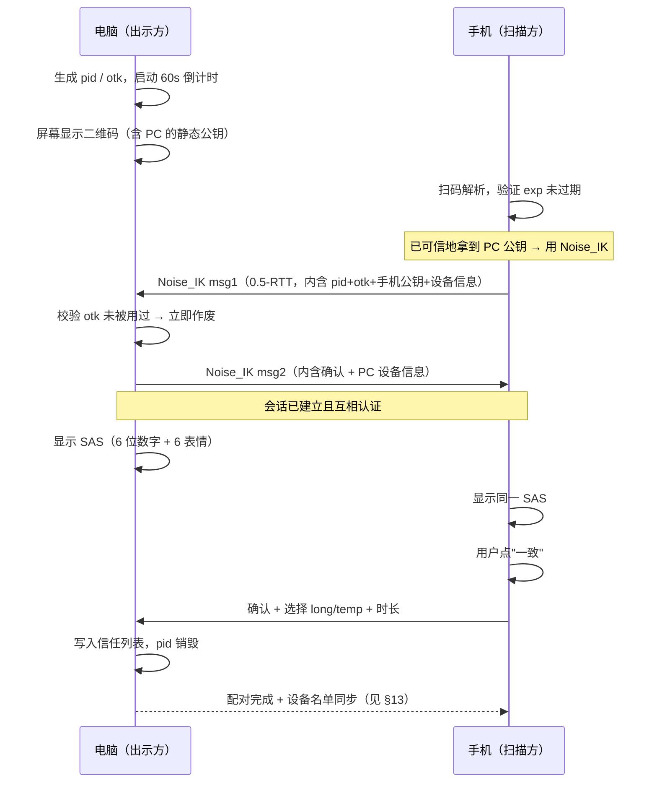

# 配对方案全集（手机 / 平板 / 电脑）

> 用户明确要求扩充配对方式。本文给出 **12 种配对通道**，每种都写清楚：适用场景、密码学流程、防中间人的原理、失败模式。
>
> 所有配对方式最终都归结到同一件事：**让双方安全地知道对方的 X25519 静态公钥**。差别只在于"用哪条带外信道传递这个公钥"以及"如何让人确认没被掉包"。

---

## 0. 配对的本质（先讲原理，后面 12 种就都好理解了）

两台设备在网络上互不认识时，任何"自动配对"都逃不过一个根本问题：

> 我收到的这个公钥，真的是对面那台设备的吗？还是中间人塞给我的？

网络本身无法回答。必须借助一条**攻击者控制不了的带外信道（Out-of-Band Channel）**：

| 带外信道 | 攻击者要攻破需要 | 强度 |
|---|---|---|
| 屏幕→摄像头（二维码） | 物理看到并替换你眼前的屏幕 | ★★★★★ |
| NFC（≤4 cm） | 物理贴到设备上 | ★★★★★ |
| USB 数据线 | 物理插线 | ★★★★★ |
| 人眼比对短码（SAS） | 让你看错两串数字 | ★★★★☆ |
| 数字口令 + PAKE | 在线猜中口令（每错一次就锁） | ★★★★☆ |
| 声波（可闻/超声） | 在同一房间录音并抢先播放 | ★★★☆☆ |
| 纯"附近设备"列表点击 | 伪装设备名骗你点错 | ★★☆☆☆（必须配 SAS） |

**结论**：二维码 / NFC / USB 是"直接可信信道"，可以直接把公钥送过去；其余方式都必须**追加一次 SAS 人眼确认或 PAKE**，否则形同虚设。

---

## 1. SAS（Short Authenticated String）——所有配对方式共用的最后一道闸

### 原理

双方用 `Noise_XX` 握手（互换临时+静态公钥）后，各自独立计算：

```
sas_input = handshake_hash          # Noise 握手过程的累积哈希，双方必然相同
sas_bytes = HKDF(sas_input, info="ClipBridge-SAS-v1", len=5)
数字码 = sas_bytes 前 20 bit → 十进制 6 位（000000~999999）
表情码 = sas_bytes 每 6 bit 查一张 64 个表情的表 → 6 个表情
```

若存在中间人 M，A↔M 和 M↔B 是两条不同的握手，`handshake_hash` 必然不同 → **两端显示的 SAS 必然不一致**。用户看到不一致就取消。

攻击者要蒙混过关，需要构造出让两条握手的哈希前 20 bit 相同的公钥 → 期望需要 2²⁰ ≈ 100 万次尝试，而每次尝试都要用户当场点一次"确认"，且失败即锁定。

### 强化：提交-揭示（Commit-Reveal）

单纯 SAS 有一个理论攻击：中间人可以先看到一方的公钥再挑自己的公钥去凑哈希。防法是让先手方**先承诺**：

```
A → B : commit = SHA-256(A的临时公钥 ‖ nonce_A)      # 只发承诺，不发公钥
B → A : B的临时公钥, nonce_B
A → B : A的临时公钥, nonce_A                          # 揭示
B 验证 commit 是否对得上；对不上立即中止
```

这样 A 在看到 B 的公钥之前就锁定了自己的选择，无法事后凑数。

### UI 呈现

```
┌────────────────────────────────┐
│  请确认两台设备显示的内容一致    │
│                                │
│        4 8 2   9 1 6           │
│      🐼  🌙  🚀  🌲  🔑  ⚓      │
│                                │
│   [ 一致，配对 ]   [ 不一致 ]   │
└────────────────────────────────┘
```

同时给数字和表情：数字便于口头核对（打电话报码），表情便于视觉快速比对（不容易看串行）。

---

## 2. 方式一：二维码配对（默认推荐）

### 2.1 适用

- 手机 ↔ 电脑（电脑显示码，手机扫）
- 手机 ↔ 平板（任一方显示，另一方扫）
- 电脑 ↔ 电脑（一台显示，另一台用摄像头扫；无摄像头则退到方式二）

**双向皆可**：谁有摄像头谁扫。UI 上永远同时提供"出示二维码"和"扫描二维码"两个按钮，不强迫用户判断该谁扫谁。

### 2.2 二维码承载内容

```json
{
  "v": 1,
  "t": "pair",
  "pid": "8f3a…",              // 一次性 pairing_id（16 字节随机）
  "did": "CB7K3M…",            // 出示方 device_id
  "pk": "base64(X25519 公钥, 32B)",   // ← 核心：直接传公钥，这就是可信信道的价值
  "spk": "base64(Ed25519 公钥, 32B)",
  "n": "小明的电脑",
  "ty": "pc",
  "otk": "base64(一次性令牌, 32B)",   // 防止二维码被拍照后重复使用
  "eps": ["192.168.1.7:39421", "[fe80::…]:39421"],  // 直连地址提示
  "ble": "a1b2c3",             // BLE 快速定位提示
  "hs": {"ssid":"…","pw":"…"}, // 可选：热点凭据（无路由器场景）
  "exp": 1785312000,           // 绝对过期时间（Unix 秒）
  "mode": "long|temp",
  "ttl": 3600                  // mode=temp 时的授权时长（秒）
}
```

CBOR 编码后 Base45/Base64URL 装进二维码，典型 **220~300 字节** → 二维码版本 8~10，纠错等级 M，**手机在 30 cm 距离、普通光照下识别时间 < 300 ms**。

带热点凭据时会涨到 ~350 字节，仍在舒适区。**超过 500 字节会明显影响识别速度**，所以 `eps` 最多放 3 个地址。

### 2.3 完整流程



### 2.4 安全要点

| 要点 | 做法 | 原因 |
|---|---|---|
| 二维码有效期 | **60 秒**，倒计时可见，过期自动刷新 | 减少被偷拍后使用的窗口 |
| 一次性令牌 | `otk` 用后立即作废，且服务端/本机记录已用列表 | 防止拍照后重复配对 |
| 二维码内容 | **只放公钥，绝不放私钥、绝不放长期口令** | 二维码可能被拍到；泄露公钥无害 |
| SAS 是否可省 | 二维码模式下**理论上可省**（可信信道已传公钥），但**默认仍显示**，可在设置里关闭 | 防"用户扫了别人屏幕上的假码"（社工攻击） |
| 截屏分享风险 | 检测到系统截屏时立即作废并提示 | 有人把配对码截图发群里 |
| 屏幕录制 | Android 端对二维码页启用 `FLAG_SECURE` | 防止录屏/远程协助软件抓走 |

### 2.5 反向二维码（无摄像头的电脑）

台式机常无摄像头。此时反过来：**手机显示二维码，电脑用……也没摄像头。** 所以真实退路是方式二（数字码）或方式五（USB）。UI 要在检测不到摄像头时**自动隐藏"扫描"按钮并推荐数字码**，而不是让用户点了才发现不能用。

---

## 3. 方式二：数字口令 / 单词码 / 表情码（PAKE）

### 3.1 为什么必须用 PAKE，不能只"限制错误次数"

朴素做法：一方显示 6 位数字，另一方输入，服务器/对端比对。问题在于**离线字典攻击**：如果口令参与了加密材料，攻击者抓到一个握手包，就能在本地穷举 100 万种可能，几秒钟破解，"限制错误次数"完全拦不住（他根本不需要再联网试）。

**PAKE（Password-Authenticated Key Exchange）** 的性质：

> 用一个低熵口令（6 位数字），协商出一个高熵会话密钥；攻击者每次**在线**猜测只能验证一个候选口令，**无法离线穷举**。

选用 **CPace**（CFRG 推荐的平衡 PAKE，比 SPAKE2 少一个可信设置步骤）：

```
双方共同输入：低熵口令 pw（6 位数字），会话上下文 sid
CPace 输出：共享高熵密钥 K
攻击者不知道 pw：只能每次在线试一个，试错 5 次即锁定 60 秒，10 次锁定 1 小时
→ 破解 100 万种组合需要数百年
```

拿到 K 之后，用 K 加密交换双方静态公钥，再走正常 `Noise_IK`。

### 3.2 三种码型（同一底层，仅呈现不同）

| 码型 | 呈现 | 熵 | 适用 |
|---|---|---|---|
| 数字码 | `482 916` | 20 bit | 通用，电话口述友好 |
| 单词码 | `橙子-火箭-琴弦-北极` | 4 词 × 11 bit = 44 bit（词表 2048） | 更好记，跨语言易读错少 |
| 表情码 | `🐼🌙🚀🌲` | 4 × 6 = 24 bit | 儿童/老人友好，无需识字 |

**推荐默认用单词码**：熵更高（44 bit，即使没有 PAKE 也够安全），且"橙子-火箭-琴弦-北极"比"482916"更不容易报错。词表用 BIP-39 中文/英文表的子集（已经过发音区分度优化）。

### 3.3 流程

```
电脑：显示  单词码：橙子-火箭-琴弦-北极   （有效期 120 秒）
手机：输入 → 自动补全 + 容错（拼音首字母即可，"cz-hj-qx-bj"）
两端 CPace → 共享密钥 K → 交换公钥 → Noise_IK → SAS 二次确认 → 完成
```

### 3.4 防暴力

```
每个配对码最多接受 5 次错误尝试
错 3 次 → 冷却 30 秒
错 5 次 → 该码立即作废，必须重新生成
同一 IP/设备 1 小时内失败 20 次 → 拉黑 24 小时
配对码有效期 120 秒（比二维码长，因为要手输）
```

---

## 4. 方式三：附近设备发现 + 一键配对

### 4.1 流程

设备在同一局域网时，双方通过 mDNS 互相看见，UI 直接列出：

```
附近的设备
──────────────────────────
📱 小明的手机      同一 Wi-Fi     [配对]
💻 客厅电脑          同一 Wi-Fi     [配对]
📱 荣耀平板          蓝牙可见       [配对]
──────────────────────────
```

点"配对" → 对端弹出请求 → **双方显示 SAS** → 都确认 → 完成。

### 4.2 关键安全点

设备名是攻击者可以任意伪造的。攻击者把自己的设备命名为"小明的手机"，用户很可能点错。**所以此方式的 SAS 确认绝不可省，且必须是双向确认（两台设备都要点）。**

UI 上对未配对设备的名字要加"未验证"标记，避免用户把它当成可信信息：

```
📱 小明的手机  ⚠️未验证名称
```

### 4.3 加速：Fast-Pair 风格的候选提示

如果本机已有一台设备属于某个群组（例如"我的设备"），且发现的新设备携带了**同群组的 BLE RPA**，说明它大概率也是用户自己的设备。此时把它置顶并标注：

```
📱 荣耀平板   ✨ 可能是你的设备（与"小明的手机"同群组）  [快速添加]
```

这不降低安全性（仍要 SAS），但显著降低选错的概率。

---

## 5. 方式四：NFC 碰一碰

### 5.1 适用

Android 手机 ↔ Android 平板；部分带 NFC 的 Windows 笔记本/外接读卡器。

### 5.2 原理

NFC 有效距离 ≤ 4 cm，攻击者要中间人必须把设备物理贴上来 → **天然可信信道**，等价于二维码。

传输内容与二维码 payload **完全相同**（同一个 CBOR 结构），走 **NDEF 消息**：

```
NDEF Record 1: External Type  "clipbridge.app:pair"  → CBOR payload（~250B）
NDEF Record 2: Android Application Record (AAR)      → 未安装 App 时跳商店
```

NFC 只做引导，**实际数据仍走 Wi-Fi/局域网**。碰一下之后：

```
碰 → 交换公钥 + 地址提示 → 自动断开 NFC → Wi-Fi 侧 Noise_IK → SAS（可选，NFC 模式默认关闭） → 完成
全程约 2~3 秒
```

### 5.3 增强：碰一碰即传

配对完成后，NFC 可复用为**动作触发器**：碰一下 = "把当前剪贴板/当前选中文件发给刚碰的设备"。这是很自然的交互，实现成本低（NDEF payload 里带一个 action 字段）。

---

## 6. 方式五：USB 有线配对

### 6.1 适用

- 企业/校园网禁止设备互相发现（AP 隔离、端口隔离）
- 电脑无摄像头且不想手输码
- 首次安全初始化（最高信任场景）
- 蓝牙/Wi-Fi 均不可用

### 6.2 两种实现

**A. ADB 通道（需用户开 USB 调试）**
```
电脑端 clipbridged 检测到 adb 设备
  → adb forward tcp:0 localabstract:clipbridge_pair
  → 通过该本地端口完成 Noise_XX 握手
  → 手机端弹窗确认
```
优点：不需要额外驱动。缺点：要求用户开开发者选项，普通用户门槛高。

**B. USB 附件模式 / AOA（推荐给普通用户）**
```
手机以 USB Accessory 模式连接 → Android 弹出系统级"是否允许 App 访问该 USB 配件"
→ 建立 bulk 传输通道 → 走同一套 Noise 握手
```
优点：无需开发者选项，系统弹窗本身就是授权确认。缺点：需要电脑端实现 libusb 层（Go 有 `gousb`）。

**C. 兜底：MTP 文件交换**
最土但最通用：电脑把配对请求写成一个小文件到手机存储，手机 App 检测到后处理。需要用户在手机端点一下"检查 USB 配对请求"。作为 A/B 都不可用时的最后退路。

### 6.3 信任等级

USB 配对默认给予**最高信任**（物理接触 = 强证据），可跳过 SAS，并默认勾选"长期设备"。

---

## 7. 方式六：临时热点 / Wi-Fi Direct（无路由器）

### 7.1 场景

野外、教室、酒店（AP 隔离）、断网环境。

### 7.2 流程

```
设备 A（有数据的一方）：点"无网络传输"
  → A 开启热点，SSID: ClipBridge-8F3A，随机 12 位密码
  → A 显示二维码，二维码里除公钥外还带 {"hs":{"ssid":"ClipBridge-8F3A","pw":"…"}}
设备 B：扫码
  → 系统 API 直接加入该 Wi-Fi（Android 10+ 用 WifiNetworkSpecifier，无需用户手输密码）
  → B 加入后 A 的 IP 固定为 192.168.43.1（Android 热点网关）→ 秒发现
  → Noise_IK → 完成
```

**技术要点**：Android 10+ 的 `WifiNetworkSpecifier` 可以让 App 请求连接指定 Wi-Fi 而**不影响系统默认网络**（数据流量仍走 5G），这对"传文件时不断网"很重要。传输结束后自动断开该网络，恢复原状。

Windows 端可用 `Mobile Hotspot`（`NetworkOperatorTetheringManager`）扮演热点方。

### 7.3 Wi-Fi Direct（Android ↔ Android）

不占用热点（可与正常 Wi-Fi 共存），带宽更高。用 `WifiP2pManager` 建组，组主的 IP 固定 `192.168.49.1`。缺点：Windows 侧支持差，仅在双 Android 时启用。

---

## 8. 方式七：链接 / 剪贴板引导配对（新增，异地友好）

### 8.1 场景

对方不在身边——想让异地的朋友临时收个文件，或自己在公司想连家里的电脑。

### 8.2 做法

生成一条深链接（Deep Link）：

```
https://cb.link/p#v1.8f3a.<base64url(CBOR payload)>
              ↑ fragment，不会被发到服务器（隐私关键：链接内容服务器看不到）
```

- 用户把链接通过微信/邮件/短信发给对方（或复制到自己的另一台设备）
- 对方点开 → 已装 App 则直接唤起配对流程；未装则落地页引导下载
- **必须配 SAS + 有效期短（10 分钟）+ 一次性**

### 8.3 安全说明（要在 UI 上说清楚）

链接走的是第三方 IM，**IM 服务商理论上能看到链接**（虽然 fragment 部分不发给我们的服务器，但 IM 自己能读消息内容）。所以：

- 该方式**默认只允许配临时设备**，不允许直接配成长期设备
- **强制 SAS 人眼确认**（此时必须靠电话/语音核对 6 位数字，这是唯一的可信信道）
- 加大 SAS 位数到 8 位数字（26 bit），因为这里的中间人风险最高
- UI 明确提示："请通过电话或当面核对下面的数字，不要在同一个聊天里发送"

### 8.4 变体：本机跨应用引导

同一用户的两台设备之间，可以把链接直接复制到剪贴板，用任何已有的同步渠道（微信文件传输助手、邮箱草稿）送过去。这是"我还没配对，所以还不能用 ClipBridge 传配对码"这个先有鸡先有蛋问题的自然解法。

---

## 9. 方式八：声波配对（新增，无摄像头无 NFC 时）

### 9.1 场景

台式机没摄像头、没 NFC、不想插线、不想手输码——但有音箱和麦克风（几乎所有电脑都有）。

### 9.2 原理

用 **18~20 kHz 近超声频段**做 FSK/Chirp 调制传输一个短 payload：

```
带宽约 200 bps（可靠），传 32 字节（256 bit）约 1.5 秒
不传公钥（太大），只传一个高熵配对口令（16 字节 = 128 bit）
→ 该口令作为 PAKE 的输入（等价于方式二，但熵高得多，人不用输）
→ CPace(口令) → 交换公钥 → Noise → 完成
```

**为什么只传口令不传公钥**：32 字节公钥 + 校验在 200 bps 下要 2+ 秒且易受噪声干扰。传 16 字节高熵口令只要 ~0.8 秒，且 PAKE 保证了即使口令被录到也需要在线尝试。

### 9.3 安全边界（必须诚实标注）

声波会**穿墙**（衰减但可能被录到）。同一房间的攻击者可以录音。因此：

- 高熵口令（128 bit）保证录到也无法离线破解 PAKE？——**不对**，录到高熵口令就等于知道口令。所以声波配对**必须**配 SAS 人眼确认。
- 默认限定为**临时设备**，除非用户额外确认升级为长期
- 加一层"响应时限"：声波发出后 15 秒内必须完成握手，超时作废

定位：**便利性方案，不是高安全方案**。UI 用黄色标注"便捷模式"。

---

## 10. 方式九：摇一摇 / 碰一碰配对（新增，两台手机）

### 10.1 原理

两台手机同时握在手里摇动（或互相轻碰），各自采集加速度计序列，上传特征给对方比对：

```
采样 100 Hz，取 3 秒窗口的加速度模长序列
提取特征：峰值时刻序列 + 主频 + 能量包络
两端交换特征的哈希承诺 → 揭示 → 计算相关系数
相关系数 > 0.85 且峰值时刻对齐误差 < 50 ms → 判定"同时被摇"
```

这构成一个**基于物理共同经历的信道**：攻击者不在你手里，摇不出同样的曲线。

### 10.2 局限

- 需要双方在同一时刻操作（3 秒窗口）
- 只适用于两台带加速度计的移动设备（手机↔手机、手机↔平板），电脑不适用
- 相关性判定有误报可能 → **仍需 SAS 确认**

定位：趣味性 + 快捷性，作为"附近设备"的加速入口，不是独立的安全基础。

---

## 11. 方式十：账号配对（可选，不强制）

### 11.1 明确定位

**账号不是使用前提**。它只解决四件本地配对做不到的事：

1. 换手机后恢复设备清单（不用把所有设备重配一遍）
2. 异地设备发现（不在同一局域网时也能找到对方）
3. 远程吊销丢失的设备
4. 跨网络中继的鉴权与配额

### 11.2 登录方式

| 方式 | 说明 |
|---|---|
| Passkey（推荐） | 无密码，抗钓鱼，用设备生物识别授权 |
| 邮箱验证码 | 门槛最低 |
| 邮箱 + 密码 + 2FA | 传统方式 |

### 11.3 关键：账号不掌握密钥

即使登录了账号，**服务器也不持有任何能解密内容的密钥**：

```
账号密码/Passkey → 派生 account_key（仅客户端持有）
设备清单、配对关系 → 用 account_key 加密后存服务器（服务器只见密文）
恢复流程：新设备登录 → 拿到密文 → 用 account_key 解密 → 得到设备清单
         → 但新设备仍需被每台老设备"批准"一次（防止账号被盗即全盘沦陷）
```

最后那句是关键设计：**账号被盗 ≠ 数据泄露**。攻击者拿到账号只能看到"你有几台设备"（密文元数据），无法直接读剪贴板，因为他没有任何一台老设备来批准新设备加入。

### 11.4 恢复码（无账号用户的备份路径）

不想注册账号的用户，可导出 **24 词助记词**（BIP-39）作为设备身份备份：

```
助记词 → BIP-39 种子 → HKDF → 设备静态密钥对 + 群组密钥
```

抄在纸上收好。换手机时输入助记词 → 恢复出**同一个 device_id 和同一对密钥** → 其他设备根本察觉不到换了机器，无需重新配对。

**这是本项目对"卸载 App 就全丢"问题的答案，且完全不需要服务器。**

---

## 12. 方式十一：设备组邀请码（新增，批量配对）

### 12.1 解决什么问题

用户有 5 台设备时，两两配对要 C(5,2) = 10 次。这是不可接受的体验。

### 12.2 传递式信任（Transitive Introduction）

```
已有：A ↔ B 已配对，A ↔ C 已配对
现在：B 想和 C 配对
```

流程：

```
B 向 A 请求"介绍 C"
A 检查：C 在我的信任列表且是长期设备
A 生成介绍凭据：
    intro = Sign_A( {B_pubkey, C_pubkey, valid_until, group_id} )
A 分别发给 B 和 C
B 和 C 各自验证 A 的签名（它们都信任 A）
→ B 和 C 直接 Noise_IK 建连
→ UI 上给用户一次确认："电脑说这台平板也是你的，要加入吗？" [是/否]
```

**用户只需确认一次，不需要再扫码。** 5 台设备的配对次数从 10 次降到 4 次（每台新设备只需和任意一台已有设备配对一次）。

### 12.3 安全边界

- 只有**长期设备**能做介绍人，临时设备不能
- 介绍凭据有效期 5 分钟，一次性
- **用户确认不可跳过**（否则一台设备被攻破 = 整个设备网沦陷）
- 撤销 A 时，A 签发的所有未过期介绍凭据同时作废
- 传递深度限制为 1 跳（不允许"A 介绍 B，B 再拿这个介绍去介绍 D"）

### 12.4 群组邀请码

也可生成一个群组邀请二维码，扫码后一次性加入整个"我的设备"组：

```json
{"t":"group-invite","gid":"…","gk_wrapped":"…","members":[{did,pk},…],"exp":…}
```

`gk_wrapped` 是用配对过程协商的密钥包裹的群组密钥。加入后新设备直接拿到全部成员公钥，无需逐个配对——但**每台老设备仍会收到通知并可一键踢出**。

---

## 13. 配对后：设备名单同步（CRDT）

配对完成的最后一步是同步设备名单，让所有己方设备的视图一致。用 **LWW-Element-Set（Last-Write-Wins 集合）** CRDT：

```
每条设备记录带 (device_id, 属性…, hlc, tombstone)
合并规则：同 device_id 取 hlc 更大的一条；tombstone=true 表示已删除
→ 任意顺序、任意次数合并，结果一致（幂等 + 交换律 + 结合律）
```

这样即使 A 在飞机上删了设备 D、同时 B 在家里改了 D 的名字，两边再联网合并时结果确定且一致，不需要中心服务器仲裁。

---

## 14. 长期设备 vs 临时设备（配对时决定）

### 14.1 配对时的选择界面

```
┌──────────────────────────────────────┐
│  这是谁的设备？                        │
│                                      │
│  ◉ 我自己的设备（长期）                │
│     自动重连、自动同步、可看历史        │
│                                      │
│  ○ 别人的设备（临时）                  │
│     ├ 仅本次连接                      │
│     ├ 10 分钟   ├ 30 分钟             │
│     ├ 1 小时    ├ 今天有效             │
│     └ 自定义…                         │
│                                      │
│  □ 阅后即焚（内容用一次即失效）         │
└──────────────────────────────────────┘
```

### 14.2 能力矩阵

| 能力 | 长期设备 | 临时设备 |
|---|---|---|
| 自动发现 + 自动重连 | ✅ | ❌（每次手动） |
| 后台保持连接 | ✅ | ❌ |
| 自动同步剪贴板 | ✅ 可配置 | ❌ 仅手动发送 |
| 接收剪贴板历史 | ✅ 可配置 | ❌ |
| 自动接收文件 | ✅ 可配置 | ❌ 必须逐次确认 |
| 看到你的其他设备 | ✅ | ❌（完全隔离） |
| 被介绍给其他设备（§12） | ✅ | ❌ |
| 做介绍人 | ✅ | ❌ |
| 持久化凭据 | ✅ 存 Keystore | ❌ 只在内存，进程退出即失 |
| 到期行为 | 永久（可手动撤销） | 自动断开 + 删密钥 + 清历史 |

### 14.3 临时设备的技术实现

关键在于**密钥不落盘**：

```go
type TempSession struct {
    peerPub    []byte
    sessionKey []byte        // 仅内存
    expiresAt  time.Time
    burnAfterRead bool
}
// 进程退出 / 到期 / 用户手动结束 → 显式 zeroize 内存
// 收到的文件若开启"阅后即焚"，存到临时目录，会话结束时删除
```

到期定时器由**双方各自独立**维护（不信任对方的时钟）。任一方到期即单方面断开并删密钥，另一方随后握手失败也会清理。

### 14.4 阅后即焚

```
剪贴板：接收端粘贴一次后，item 标记为已消费 → 从内存和数据库删除 → 通知发送端"已阅"
文件：下载完成后令牌失效，不写入下载记录，不生成缩略图缓存
历史：全程不写 clip_items 表，只在内存队列中
截图防护：Android 侧对阅后即焚内容的展示页启用 FLAG_SECURE
```

**诚实说明**：无法阻止接收方截屏后再用别的方式保存，也无法阻止他手抄下来。"阅后即焚"防的是**无意残留**，不是防**有意窃取**。UI 上不要暗示后者。

---

## 15. 12 种配对方式速查

| # | 方式 | 手机↔电脑 | 手机↔平板 | 电脑↔电脑 | 需网络 | 安全强度 | 默认信任 |
|---|---|:--:|:--:|:--:|:--:|:--:|---|
| 1 | 二维码 | ✅ | ✅ | 需摄像头 | 局域网 | ★★★★★ | 长期可选 |
| 2 | 数字/单词/表情码 (PAKE) | ✅ | ✅ | ✅ | 局域网 | ★★★★☆ | 长期可选 |
| 3 | 附近设备 + SAS | ✅ | ✅ | ✅ | 局域网 | ★★★★☆ | 长期可选 |
| 4 | NFC 碰一碰 | 部分 | ✅ | ❌ | 之后需 Wi-Fi | ★★★★★ | 长期 |
| 5 | USB 有线 | ✅ | ✅ | ✅ | 不需要 | ★★★★★ | 长期 |
| 6 | 临时热点 / Wi-Fi Direct | ✅ | ✅ | ✅ | 不需要路由器 | ★★★★★ | 长期可选 |
| 7 | 链接 / 深链接 | ✅ | ✅ | ✅ | 互联网 | ★★★☆☆ | **仅临时** |
| 8 | 声波 | ✅ | ✅ | ✅ | 局域网 | ★★★☆☆ | **仅临时** |
| 9 | 摇一摇 | ❌ | ✅ | ❌ | 局域网 | ★★★☆☆ | 长期可选 |
| 10 | 账号 | ✅ | ✅ | ✅ | 互联网 | ★★★★☆ | 需老设备批准 |
| 11 | 设备组介绍/邀请码 | ✅ | ✅ | ✅ | 局域网 | ★★★★☆ | 继承介绍人 |
| 12 | 助记词恢复 | ✅ | ✅ | ✅ | 不需要 | ★★★★★ | 恢复原身份 |

**产品上的取舍**：主界面只暴露 **二维码 / 附近设备 / 输入配对码** 三个入口，其余 9 种放在"更多配对方式"里。给普通用户 3 个选择，给需要的人 12 个选择。
