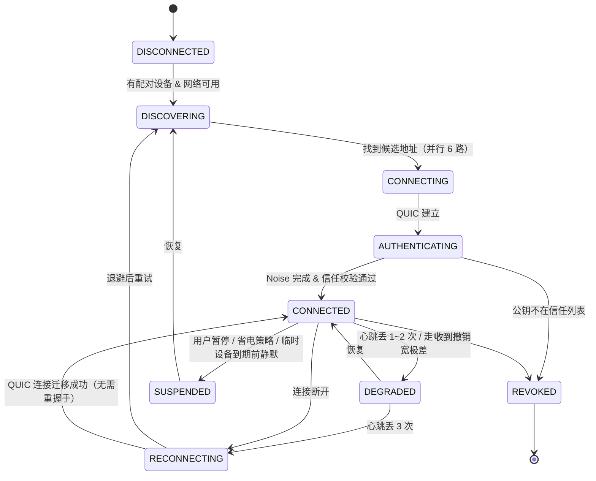

# ClipBridge 线协议规范 v1

> 这份文档的目标是**可以照着直接写代码**。所有字段、长度、状态转移都定死。

---

## 1. 总体分层

```
┌─────────────────────────────────────────┐
│ 应用消息（CBOR）  Clip / Transfer / Ctrl │
├─────────────────────────────────────────┤
│ 帧层  [u8 type][u8 flags][u32 len][body] │
├─────────────────────────────────────────┤
│ Noise_IK / Noise_XX  加密与身份认证       │
├─────────────────────────────────────────┤
│ QUIC Stream（TLS1.3 传输加密）            │
│   ↓ 降级：TCP+TLS1.3 / WSS               │
└─────────────────────────────────────────┘
```

**双层加密说明**：QUIC/TLS 保护传输，Noise 保护身份与内容。中间人即使伪造 TLS 证书，Noise 握手会失败。

---

## 2. 常量

```go
const (
    ProtoVersion   = 1
    ServiceType    = "_clipbridge._udp"
    DefaultPort    = 39421          // UDP(QUIC) 与 TCP 同号
    NoisePrologue  = "ClipBridge/1"

    // 帧长上限分两档。控制帧本就该很小，卡死 1 MiB 让畸形控制帧的
    // 内存放大攻击面保持很小；只有 XFER_CHUNK 允许到 17 MiB
    // （最大块 16 MiB + CBOR 头）。若两者共用一个上限，
    // 要么大文件传不了，要么所有控制帧都能塞 17 MiB。
    MaxFrameSize      = 1 << 20                // 1 MiB —— 除 XFER_CHUNK 外全部
    MaxChunkFrameSize = (16 << 20) + (1 << 20) // 17 MiB —— 仅 XFER_CHUNK
    InlineRepLimit = 4 << 10        // 4 KiB：小于此值的剪贴板表示内联传输
    DefaultChunk   = 4 << 20        // 4 MiB
    MinChunk       = 1 << 20
    MaxChunk       = 16 << 20

    HeartbeatIdle  = 10 * time.Second
    HeartbeatMiss  = 3               // 连续 3 次无响应 → RECONNECTING
    IdleTimeout    = 30 * time.Second

    QRTTL          = 60 * time.Second
    CodeTTL        = 120 * time.Second
    LinkTTL        = 10 * time.Minute
    TicketTTL      = 7 * 24 * time.Hour

    DedupWindow    = 200            // 最近 N 条 item_id 用于去重
    EchoSuppress   = 5 * time.Second
)
```

---

## 3. 帧格式

```
 0        1        2                6                        6+len
 +--------+--------+----------------+-------------------------+
 |  type  | flags  |   length u32   |         payload         |
 +--------+--------+----------------+-------------------------+
   u8       u8        big-endian
```

`flags` 位：

| bit | 名称 | 含义 |
|---|---|---|
| 0 | `FIN` | 该逻辑消息的最后一帧 |
| 1 | `COMP` | payload 已用 zstd 压缩 |
| 2 | `ACKREQ` | 需要对端回 ACK |
| 3 | `URGENT` | 优先投递（心跳、控制） |
| 4-7 | 保留 | 必须为 0 |

`type` 取值：

| 值 | 名称 | 方向 | 说明 |
|---|---|---|---|
| 0x01 | `HELLO` | 双向 | 连接建立后第一条，交换能力 |
| 0x02 | `HEARTBEAT` | 双向 | 心跳 |
| 0x03 | `ACK` | 双向 | 确认 |
| 0x04 | `ERROR` | 双向 | 错误 |
| 0x10 | `CLIP_ANNOUNCE` | 推 | 剪贴板元数据（含小表示内联） |
| 0x11 | `CLIP_FETCH` | 拉 | 请求某个表示的正文 |
| 0x12 | `CLIP_DATA` | 应答 | 表示正文 |
| 0x13 | `CLIP_REVOKE` | 推 | 撤回 |
| 0x20 | `XFER_OFFER` | 推 | 传输邀约（含 manifest） |
| 0x21 | `XFER_ACCEPT` | 应答 | 接受（含已有分块位图 → 断点续传） |
| 0x22 | `XFER_REJECT` | 应答 | 拒绝 |
| 0x23 | `XFER_CHUNK` | 推 | 分块数据 |
| 0x24 | `XFER_STATUS` | 双向 | 进度/暂停/取消/请求重传 |
| 0x25 | `XFER_DONE` | 应答 | 校验通过，完成 |
| 0x30 | `DEV_ROSTER` | 双向 | 设备名单 CRDT 合并 |
| 0x31 | `DEV_REVOKE` | 推 | 撤销通知（带签名） |
| 0x32 | `DEV_INTRO` | 推 | 传递式介绍凭据 |
| 0x40 | `PAIR_*` | 双向 | 配对子协议（仅配对通道使用） |

---

## 4. 握手

### 4.1 已配对重连：`Noise_IK`

```
prologue = "ClipBridge/1" ‖ initiator_device_id ‖ responder_device_id
-> e, es, s, ss  [payload: HELLO]      # 0.5-RTT，第一个包就带业务数据
<- e, ee, se     [payload: HELLO]
```

`msg1` 的 payload（HELLO）内容：

```cbor
{
  1: 1,                    // ver
  2: h'…',                 // device_id (16B)
  3: "小明的手机",         // name
  4: "phone",              // type
  5: ["clip","file","folder","relay","ime"],   // caps
  6: 1187,                 // last_recv_seq —— 对端据此补发
  7: h'…',                 // resumption_ticket（可选）
  8: 1785312000            // unix_ms
}
```

**服务端（responder）必须校验**：
- initiator 的静态公钥 `s` 是否在信任列表；不在 → 立即断开，不给任何区分性错误信息（防止被用来枚举）
- 该设备是否为临时设备且已过期 → 断开并本地删除
- `resumption_ticket` 是否有效、未被撤销

### 4.2 首次配对：`Noise_XX` + SAS

```
-> e                    [payload: commit = SHA256(e_pub ‖ nonce_i)]
<- e, ee, s, es         [payload: responder 信息 ‖ nonce_r]
-> s, se                [payload: initiator 信息 ‖ nonce_i (揭示)]
```

responder 收到 msg3 后校验 commit。双方各自计算：

```
sas = HKDF-SHA256(ikm = handshake_hash, salt = nonce_i ‖ nonce_r,
                  info = "ClipBridge-SAS-v1", L = 5)
digits = (be_uint20(sas[0:3] >> 4)) % 1000000     // 6 位
emoji  = [EMOJI_TABLE[b & 0x3F] for b in sas[0:6]]  // 6 个
```

两端 UI 显示后各自等待用户确认；任一方否定 → `PAIR_ABORT` 并把该 pairing_id 拉黑。

### 4.3 配对子协议消息（type 0x40 段）

| 子类型 | 名称 | 内容 |
|---|---|---|
| 0x40 | `PAIR_HELLO` | pairing_id, 方式(qr/code/nearby/nfc/usb/link/sound/shake), 一次性令牌 |
| 0x41 | `PAIR_PAKE1` | CPace 消息 1（仅数字码方式） |
| 0x42 | `PAIR_PAKE2` | CPace 消息 2 |
| 0x43 | `PAIR_SAS_READY` | 我已显示 SAS |
| 0x44 | `PAIR_CONFIRM` | 用户确认 + {mode: long/temp, ttl, 权限位} |
| 0x45 | `PAIR_ABORT` | 取消 + 原因码 |
| 0x46 | `PAIR_DONE` | 完成 + resumption_ticket + 设备名单 |

**配对握手载荷必须携带对方的监听地址。** 配对用的那条连接是临时的，
对端的源端口是随机分配的，拿它回拨必然失败。双方要在 Noise 握手载荷里
交换各自的**监听**地址（扫码方还额外知道自己真正拨通了哪个地址）。
少了这一步，配对会显示成功，但之后谁也连不上谁，只能干等 mDNS 重新发现。

**`PAIR_DONE` 必须双向且都要读到对方那条才算结束。** 只发不等会出一个偶发 bug：
先做完的一方立刻关连接，QUIC 的 `CONNECTION_CLOSE` 会丢弃尚未送达的流数据，
另一方可能永远读不到确认，于是**它这一侧根本没把对端写进信任列表**——
表现为"提示配对成功，但之后连不上"，且只在时序偏移时出现。

---

## 5. 剪贴板消息

### 5.1 `CLIP_ANNOUNCE` (0x10)

```cbor
{
  1: h'…',            // item_id = BLAKE3(canonical(preferred_payload))[:16]
  2: "…",             // hlc: "<unix_ms>.<counter>.<device_id前4字节>"
  3: h'…',            // source device_id
  4: "text/x-tex",    // preferred mime
  5: false,           // sensitive
  6: 1785312060000,   // expires_at_ms，0 = 不过期
  7: [                // reps
       {1:"text/plain;charset=utf-8", 2:12,    3:h'…', 4:h'45203D206D63B2'},  // 4=inline
       {1:"text/x-tex",               2:10,    3:h'…', 4:h'…'},
       {1:"image/png",                2:48210, 3:h'…'}                        // 无 4 → 需 FETCH
     ],
  8: ["dev1","dev2"], // 目标设备（空 = 广播给所有已授权设备）
  9: 1187             // seq
}
```

**发送方规则**：
- `size ≤ InlineRepLimit(4KiB)` → 必须内联（字段 4）
- `size > 4KiB` → 只发 hash+size，等对方 `CLIP_FETCH`
- 至少要有一个 `text/plain` 表示（图片除外）

**接收方规则**：
```
if item_id ∈ 最近 200 条  → 丢弃（去重）
if source == self         → 丢弃（防回环）
比较 hlc 与当前项：更新则替换当前项，更旧则只入历史
写入系统剪贴板前：把 item_id 加入 recentlyWritten（5 秒过期）
```

### 5.2 `CLIP_FETCH` (0x11) / `CLIP_DATA` (0x12)

```cbor
FETCH: {1: item_id, 2: "image/png", 3: range_start, 4: range_len}
DATA : {1: item_id, 2: "image/png", 3: offset, 4: h'…bytes…', 5: is_last}
```

大表示分块传输，复用 `XFER` 的分块机制（≥16 MiB 时）。

### 5.3 `CLIP_REVOKE` (0x13)

```cbor
{1: item_id, 2: reason}   // reason: "user"|"expired"|"burn_after_read"
```

---

## 6. 文件传输消息

### 6.1 `XFER_OFFER` (0x20)

```cbor
{
  1: h'…',              // transfer_id (16B 随机)
  2: 3,                 // file_count
  3: 1288490188,        // total_size
  4: 4194304,           // chunk_size
  5: "folder",          // kind: "file"|"files"|"folder"
  6: "素材",             // display_name
  7: [                  // manifest（大清单时分帧传，FIN 标记结束）
       {1:"a/1.png",  2:120340, 3:h'merkle…', 4:1785300000, 5:0o644, 6:false},
       {1:"a/sub",    2:0,      6:true},          // 6 = is_dir
       {1:"b.pdf",    2:9284011,3:h'merkle…', 4:1785300100, 5:0o644, 6:false}
     ],
  8: false              // 是否阅后即焚
}
```

### 6.2 `XFER_ACCEPT` (0x21) —— 断点续传的核心

```cbor
{
  1: transfer_id,
  2: [                          // 每个文件的已有分块位图（zstd 压缩的 bitset）
       {1:0, 2:h'bitmap…'},     // 1 = file index, 2 = bitmap
       {1:2, 2:h'…'}
     ],
  3: [1],                       // 秒传：这些 index 的文件本地已有相同 merkle root，跳过
  4: "D:\\Downloads\\素材"       // 接收端选择的落地目录（仅用于回显）
}
```

发送端据此**只发缺失分块**。若 `2` 为空数组 = 全新传输。

### 6.3 `XFER_CHUNK` (0x23)

为降低开销，chunk 走**独立的 QUIC 单向流**，流的第一帧带头部，后续是纯字节：

```
帧1: {1: transfer_id, 2: file_index, 3: chunk_index, 4: chunk_len, 5: h'blake3-32B'}
帧2..n: 纯二进制数据（不再包 CBOR，省开销）
```

接收端每收满一块 → 校验 BLAKE3 → 写盘 → 置位 bitmap。每 16 块或 5 秒 fsync 一次 bitmap。

### 6.4 `XFER_STATUS` (0x24)

```cbor
{1: transfer_id, 2: "progress"|"pause"|"resume"|"cancel"|"resend",
 3: bytes_done, 4: [需重传的 (file_index, chunk_index) 列表]}
```

### 6.5 `XFER_DONE` (0x25)

```cbor
{1: transfer_id, 2: true, 3: "校验通过", 4: [失败的 file_index…]}
```

接收端全部校验通过后，把 `.cbpart` **原子 rename** 为最终名。

---

## 7. 连接状态机



**状态转移的关键点**：
- `RECONNECTING → CONNECTED` 有一条**直达边**：QUIC 连接迁移成功时根本不经过 `DISCOVERING/AUTHENTICATING`，加密上下文保留，耗时 ≈ 1 RTT
- `REVOKED` 是终态，必须删除本地凭据

---

## 8. 重连候选竞速算法

```go
func (m *Manager) Reconnect(peer *Peer) (*Conn, error) {
    ctx, cancel := context.WithTimeout(context.Background(), 15*time.Second)
    defer cancel()

    cands := []candidate{
        {addr: peer.LastGoodAddr, delay: 0},                    // 路1
        {addrs: peer.CachedAddrs, delay: 0},                    // 路2
        {src: mdnsQuery(peer.ID), delay: 0},                    // 路3
        {src: subnetBroadcast(peer.ID), delay: 50 * ms},        // 路4
        {src: bleHint(peer.ID), delay: 200 * ms},               // 路5
        {src: signalingThenRelay(peer.ID), delay: 500 * ms},    // 路6
    }

    results := make(chan *Conn, len(cands))
    for _, c := range cands {
        go func(c candidate) {
            select {
            case <-time.After(c.delay):
            case <-ctx.Done():
                return
            }
            if conn, err := dialAndHandshake(ctx, peer, c); err == nil {
                select {
                case results <- conn:
                default:
                    conn.Close() // 已有赢家，关掉
                }
            }
        }(c)
    }

    select {
    case conn := <-results:
        cancel()                    // 取消其余所有尝试
        peer.LastGoodAddr = conn.RemoteAddr()
        return conn, nil
    case <-ctx.Done():
        return nil, ErrAllPathsFailed
    }
}
```

**分级延迟（staggered start）**的原因：路 1/2/3 几乎零成本且命中率最高，立即发；路 4/5/6 有资源开销（广播扰民、BLE 耗电、消耗服务器配额），延后一点点发，避免 90% 的情况下白白付出这些成本。

### 8.1 同时互拨（glare）必须有确定性决胜规则

双方都开着自动重连时，A 拨 B 的同时 B 也在拨 A，于是两台设备各自持有两条连接。

如果两端都按"保留新连接、关掉旧的"处理，就会互相把对方保留的那条踢掉，各自的重连循环又立刻补上——**连接持续抖动**，日志里看起来像网络不稳定，实际是协议缺陷。

规则：**device_id 字典序较小的一方作为拨号方，那条连接胜出。**

```go
func (s *Session) preferred() bool {
    shouldDial := myDeviceID < peerDeviceID
    return s.initiator == shouldDial
}
```

两端各自计算，结果必然一致，因此两条并存的连接里恰好一条 `preferred()==true`，
不会出现"都留"或"都关"。输掉的一方静默关闭自己那条即可。

**配套的状态修正**：输掉的那条连接关闭时会唤醒重连循环并把状态置为 `RECONNECTING`，
但另一条其实好好连着。因此 `Connect()` 在发现已有会话而提前返回时，**必须把状态改回 `CONNECTED`**，
否则 UI 会永远显示"重连中"。

---

## 9. mDNS 记录

```
PTR   _clipbridge._udp.local              → CB7K3M8F._clipbridge._udp.local
SRV   CB7K3M8F._clipbridge._udp.local     → 0 0 39421 CB7K3M8F.local
TXT   CB7K3M8F._clipbridge._udp.local     → v=1
                                            id=CB7K3M8FQ2X…
                                            fp=<x25519 pub 前 16B base64>
                                            n=<UTF-8 设备名>
                                            t=phone
                                            c=clip,file,folder
                                            p=39421
A/AAAA CB7K3M8F.local                     → 192.168.1.7 / fe80::…
```

TTL：SRV/A 120 秒，TXT 4500 秒。上线时发 3 次 announce（0s / 1s / 3s），下线时发 goodbye（TTL=0）。

传输标签用 `_udp` 而不是 `_tcp`：底下跑的是 QUIC，真真切切监听在 UDP 上。早期草稿写成 `_tcp`，
拿 Bonjour / `dns-sd` 之类的标准工具排查时会对不上，已改正。

**实现状态**：`core/discovery` 已落地（公布 + 持续浏览 + 地址缓存 + 换网即刷新），
并作为第 3 路候选接进了 §8 的重连竞速。TXT 里的 `p=` 优先于 SRV 端口——SRV 在某些
代理/中继场景会被改写，而 TXT 是我们自己写进去的。

---

## 10. 错误码

| 码 | 名称 | 含义 | 客户端行为 |
|---|---|---|---|
| 1 | `PROTO_VERSION` | 版本不兼容 | 提示升级，不重试 |
| 2 | `UNTRUSTED` | 公钥不在信任列表 | 不重试，提示重新配对 |
| 3 | `EXPIRED` | 临时设备已到期 | 删除本地凭据 |
| 4 | `REVOKED` | 已被撤销 | 删除本地凭据，终态 |
| 5 | `BUSY` | 对端资源不足 | 退避重试 |
| 6 | `REJECTED` | 用户拒绝 | 不重试 |
| 7 | `NO_SPACE` | 目标磁盘空间不足 | 提示用户，不重试 |
| 8 | `BAD_CHUNK` | 分块校验失败 | 重传该块（≤3 次） |
| 9 | `PATH_UNSAFE` | 路径不安全 | 中止该文件，记审计日志 |
| 10 | `RATE_LIMIT` | 触发限流 | 退避 |
| 11 | `PAIR_TIMEOUT` | 配对超时 | 重新生成配对码 |
| 12 | `SAS_MISMATCH` | 用户报告 SAS 不一致 | **立即中止 + 拉黑该 pairing_id + 记审计日志（可能有中间人）** |

---

## 11. 实现约束（M1 实测踩出来的，不是理论）

以下几条不是风格建议，是不遵守就会出 bug 的硬约束。每条都对应 M1 开发中实际踩过的坑。

### 11.1 帧分发器里绝不能同步等待应答

`CLIP_ANNOUNCE` 收到后若发现表示需要按需拉取，**不能在分发器里同步等 `CLIP_DATA`**。

原因：分发器本身就跑在读循环里，而 `CLIP_DATA` 只能由这个读循环收进来 → **死锁**。
连接看起来还"活着"（QUIC 层没断），但再也不动了，且只在内容超过内联阈值时触发。

正确做法：需要请求-应答的处理放到独立 goroutine，分发器立刻返回。

### 11.2 临时设备的到期只信本地时钟

到期判断绝不采信对端自报的时间戳。双方各自独立维护定时器，任一方到期即单方面断开并清除密钥。

### 11.3 分块写入必须幂等

`WriteChunk(index, data)` 对已经收到的块直接返回成功。重复消息、重连后的重叠补传都会导致同一块到达多次，不幂等就会造成进度错乱或重复写盘。

### 11.4 一切"原子落地"都要用临时文件 + rename

文件正文写 `.cbpart`、进度位图写 `.cbstate.tmp`、设备库写 `.json.tmp`，全部校验通过后再 `rename`。
进程可能在任意时刻被杀（Android 尤其如此），磁盘上必须永远不出现"看起来完整但其实是半个"的文件。

### 11.5 未知帧类型必须忽略而不是断连

新版本新增的消息类型不应该让旧版本断开连接。但**未定义的标志位（flags bit 4~7）必须拒绝**——
容忍未知标志位会给未来的降级攻击留口子。这两条看起来矛盾，实则区别在于：
新增消息类型是向前兼容的正常演进，而标志位空间是安全语义的一部分。

---

## 12. 版本演进规则

- CBOR 用**整数键**，新增字段用新整数键，**解析时忽略未知键**
- `HELLO` 里的 `caps` 数组做能力协商，双方取交集
- 主版本号变更（不兼容）时，旧版收到新版 `HELLO` 返回 `PROTO_VERSION` 错误并提示升级
- **加密套件不做协商**（防降级攻击）；换套件 = 升主版本
